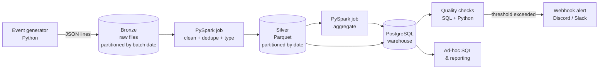

# App Event Data Pipeline

Batch data pipeline that ingests mobile app usage events, cleans them with PySpark, loads them into a PostgreSQL warehouse and runs automated data quality checks with alerting.

Built as a compact, reproducible example of a production-style ETL: layered storage (bronze / silver / gold), idempotent daily runs, date partitioning, documented data model and proactive anomaly detection. Everything starts with one command.


---

## Table of contents

- [Architecture](#architecture)
- [Tech stack](#tech-stack)
- [Quick start](#quick-start)
- [Local development](#local-development)
- [Pipeline stages](#pipeline-stages)
- [Data model](#data-model)
- [Data quality checks](#data-quality-checks)
- [Design choices](#design-choices)
- [Example queries](#example-queries)
- [Project structure](#project-structure)
- [Configuration](#configuration)
- [Testing](#testing)
- [Roadmap](#roadmap)

---

## Architecture



| Layer | Storage | Content |
|---|---|---|
| **Bronze** | JSON lines on disk, `data/bronze/batch_date=YYYY-MM-DD/` | Raw events exactly as received, grouped by arrival day, never modified |
| **Silver** | Parquet, `data/silver/event_date=YYYY-MM-DD/` + `silver.events` table | Typed, validated, deduplicated events |
| **Gold** | PostgreSQL `gold.*` tables | Business aggregates ready for reporting |

---

## Tech stack

Versions are chosen together, starting from the most constraining component (Spark), and pinned for reproducibility.

| Component | Version | Why |
|---|---|---|
| **Apache Spark / PySpark** | 4.1 | Current stable minor release, supported until mid-2027. 3.5 LTS would be the conservative alternative |
| **Python** | 3.12 | Supported by Spark 4.x and the data ecosystem (pyarrow, pandas), security fixes until October 2028 |
| **Java** | 17 | Runtime required by Spark 4.x |
| **PostgreSQL** | 18 | Current stable major version, supported until November 2030 |
| **uv** | latest | Python version, virtual environment and dependency management, with a lockfile |
| **Docker Compose** | latest | Runs PostgreSQL and the Spark runner with no local install |

Pinned in: `.python-version` (Python), `pyproject.toml` + `uv.lock` (Python dependencies), `Dockerfile` (Java, Spark), `docker-compose.yml` (PostgreSQL image tag).

---

## Quick start

**Requirements:** Docker and Docker Compose. Nothing else to install.

```bash
git clone https://github.com/noah-blanchard/app-event-data-pipeline.git
cd app-event-data-pipeline
cp .env.example .env

# Start PostgreSQL and the Spark runner
docker compose up -d

# Generate 7 days of synthetic events (~1M rows), then run the full pipeline
docker compose run --rm pipeline make generate DAYS=7
docker compose run --rm pipeline make run-all
```

Run a single day (the pipeline is idempotent, re-running a date replaces it):

```bash
docker compose run --rm pipeline make run DATE=2026-10-20
```

Open a SQL shell on the warehouse:

```bash
docker compose exec postgres psql -U pipeline -d warehouse
```

---

## Local development

For working on the code outside Docker (editor support, fast iteration on the generator and unit tests). Requires [uv](https://docs.astral.sh/uv/).

```bash
uv sync                 # installs Python 3.12 if needed, creates .venv, installs locked dependencies
uv run ruff check .     # lint
uv run ruff format .    # format
uv run pytest           # tests
```

Always run project commands through `uv run` so they use the pinned interpreter and dependencies. Spark jobs and the warehouse run in Docker; there is no need to install Java, Spark or PostgreSQL locally.

---

## Pipeline stages

### 1. Generate (`generator/`)

Produces realistic mobile app usage events as JSON lines, one folder per day.

- Configurable volume, number of users, devices and apps
- Realistic distributions: daily activity peaks, heavy-tailed session durations, popular vs. niche apps
- **Deliberately injected defects** to exercise the quality layer: null fields, duplicate events, malformed timestamps, future timestamps, negative durations, late-arriving events (event from day D delivered in day D+1's batch)

### 2. Clean: bronze → silver (`jobs/bronze_to_silver.py`)

- Enforces an explicit schema (no type inference)
- Parses and normalizes timestamps to UTC
- Rejects invalid rows into a quarantine table `silver.rejected_events` with a rejection reason, instead of silently dropping them
- Deduplicates on `event_id`, keeping the earliest ingestion
- Writes Parquet partitioned by `event_date`

### 3. Aggregate: silver → gold (`jobs/silver_to_gold.py`)

Computes daily business metrics and loads them into PostgreSQL (see [Data model](#data-model)).

### 4. Check (`quality/`)

Runs the quality rules on the freshly loaded partition, stores every result in `quality.check_results` and sends an alert if a rule fails.

---

## Data model

### `silver.events`

One row per valid, deduplicated event.

| Column | Type | Nullable | Description |
|---|---|---|---|
| `event_id` | `UUID` | no | Unique event identifier, primary key |
| `user_id` | `BIGINT` | no | Anonymous user identifier |
| `device_model` | `TEXT` | no | Device model, e.g. `Redmi Note 13` |
| `os_version` | `TEXT` | yes | OS version string |
| `app_id` | `TEXT` | no | Application identifier |
| `event_type` | `TEXT` | no | One of `app_open`, `app_close`, `screen_view`, `click`, `crash` |
| `event_ts` | `TIMESTAMPTZ` | no | When the event happened on the device (UTC) |
| `ingested_ts` | `TIMESTAMPTZ` | no | When the pipeline received the event (UTC) |
| `duration_ms` | `INTEGER` | yes | Session or screen duration, set for `app_close` and `screen_view` |
| `country` | `CHAR(2)` | yes | ISO 3166-1 alpha-2 country code |
| `event_date` | `DATE` | no | Partition key, derived from `event_ts` |

### `silver.rejected_events`

| Column | Type | Description |
|---|---|---|
| `raw_payload` | `JSONB` | Original event, unchanged |
| `reason` | `TEXT` | Rejection rule, e.g. `null_user_id`, `future_timestamp` |
| `batch_date` | `DATE` | Batch in which the event arrived |
| `rejected_ts` | `TIMESTAMPTZ` | When it was rejected |

### Gold tables

| Table | Grain | Key metrics |
|---|---|---|
| `gold.daily_active_users` | day | `dau`, `new_users`, `returning_users` |
| `gold.app_usage_daily` | day × app | `active_users`, `sessions`, `total_duration_ms`, `avg_session_ms` |
| `gold.device_daily` | day × device model | `active_users`, `crash_count`, `crash_rate` |
| `gold.country_daily` | day × country | `active_users`, `sessions` |

Full data dictionary with business definitions: [`docs/data_dictionary.md`](docs/data_dictionary.md).

---

## Data quality checks

Every check runs on the partition just loaded. Results are persisted, so data quality can be tracked over time.

| Check | Rule | Severity |
|---|---|---|
| **Freshness** | The partition for the run date exists and is not empty | critical |
| **Volume anomaly** | Row count within ±30% of the trailing 7-day average | warning |
| **Null rate** | `null(column) / rows` below threshold for each required column | critical |
| **Duplicates** | No duplicate `event_id` in silver | critical |
| **Rejection rate** | Rejected events below 5% of the raw batch | warning |
| **Referential sanity** | `duration_ms >= 0`, `event_ts <= ingested_ts` | critical |
| **Gold reconciliation** | Sum of sessions in `gold.app_usage_daily` equals the count in silver | critical |

Thresholds live in [`quality/rules.yaml`](quality/rules.yaml). A failed **critical** check marks the run as failed and sends an alert; a failed **warning** sends an alert only.

Example alert:

```
[warning] volume_anomaly on 2026-10-20
rows=612,430  expected=871,200 ± 30%  (trailing 7-day avg)
```

---

## Design choices

**Partitioning by event date.** Almost every query filters on a date range. Partitioning by `event_date` lets Spark prune files and lets PostgreSQL scan only the relevant partitions. The partition key is derived from the device timestamp, not the ingestion time, so metrics describe when usage happened. Bronze is the exception: it stores events as received, so it is partitioned by `batch_date` (arrival day), and a late event sits in the batch it arrived in until silver moves it to its `event_date`.

**Late-arriving events.** Events can reach the pipeline days after they happened. Each run reprocesses a configurable lookback window (default: 2 days) and rewrites the affected partitions, so late events land in the correct day.

**Idempotency.** Every write replaces whole partitions (`DELETE` + `INSERT` in one transaction for PostgreSQL, dynamic partition overwrite for Parquet). Running the same date twice gives the same result, which makes backfills and retries safe.

**Quarantine instead of drop.** Invalid rows go to `silver.rejected_events` with a reason. Nothing disappears silently, rejection rates become a monitored metric and bad rows can be replayed after a fix.

**Explicit schemas.** Schemas are declared in code. Schema inference is convenient but silently changes types when the input changes, which breaks downstream tables.

**Indexing in the warehouse.** Gold tables are indexed on their grain, e.g. `(event_date, app_id)`. `silver.events` uses native PostgreSQL range partitioning by `event_date` plus a B+ tree index on `(event_date, user_id)` for user-level queries.

**Validate at write time.** Values such as timestamps are normalized once, when they enter the system, so read-time queries compare clean typed columns and can use indexes instead of casting every row.

**Pinned versions.** Python, dependencies, Java, Spark and PostgreSQL are all pinned, so the pipeline behaves the same on any machine and over time.

---

## Example queries

Daily active users over the last week:

```sql
SELECT event_date, dau
FROM gold.daily_active_users
WHERE event_date >= CURRENT_DATE - INTERVAL '7 days'
ORDER BY event_date;
```

Top 5 apps by total usage time yesterday:

```sql
SELECT app_id, total_duration_ms / 3600000.0 AS hours
FROM gold.app_usage_daily
WHERE event_date = CURRENT_DATE - 1
ORDER BY total_duration_ms DESC
LIMIT 5;
```

Device models with the highest crash rate (minimum 1,000 users):

```sql
SELECT device_model, crash_rate
FROM gold.device_daily
WHERE event_date = CURRENT_DATE - 1
  AND active_users >= 1000
ORDER BY crash_rate DESC
LIMIT 10;
```

7-day retention of users first seen on a given day:

```sql
WITH cohort AS (
    SELECT user_id
    FROM silver.events
    GROUP BY user_id
    HAVING MIN(event_date) = DATE '2026-10-14'
)
SELECT COUNT(DISTINCT e.user_id)::float / (SELECT COUNT(*) FROM cohort) AS d7_retention
FROM silver.events e
JOIN cohort c USING (user_id)
WHERE e.event_date = DATE '2026-10-21';
```

More in [`sql/`](sql/).

---

## Project structure

```
app-event-data-pipeline/
├── docker-compose.yml          # PostgreSQL 18 + Spark runner
├── Dockerfile                  # Python 3.12, PySpark 4.1, Java 17
├── Makefile                    # generate, run, run-all, check, test
├── pyproject.toml              # project metadata and dependencies
├── uv.lock                     # exact dependency versions (committed)
├── .python-version             # pinned Python version
├── .env.example
├── generator/
│   └── generate_events.py      # synthetic events + injected defects
├── jobs/
│   ├── bronze_to_silver.py     # schema, validation, dedupe, quarantine
│   ├── silver_to_gold.py       # daily aggregates
│   └── common/                 # Spark session, schemas, config
├── quality/
│   ├── rules.yaml              # thresholds
│   ├── checks.py               # check runner
│   └── alerting.py             # webhook notifications
├── sql/
│   ├── schema/                 # DDL: schemas, partitions, indexes
│   └── analysis/               # example analytical queries
├── tests/                      # pytest: transformations and checks
└── docs/
    ├── architecture.md
    └── data_dictionary.md
```

---

## Configuration

All settings come from environment variables (see `.env.example`).

| Variable | Default | Description |
|---|---|---|
| `POSTGRES_USER` / `POSTGRES_PASSWORD` / `POSTGRES_DB` | `pipeline` / `pipeline` / `warehouse` | Warehouse credentials |
| `EVENTS_PER_DAY` | `150000` | Generator volume |
| `NUM_USERS` | `20000` | Distinct users in the generator |
| `DEFECT_RATE` | `0.02` | Share of events with an injected defect |
| `SEED` | `42` | Random seed, makes generated data reproducible |
| `LOOKBACK_DAYS` | `2` | Partitions reprocessed per run for late events |
| `ALERT_WEBHOOK_URL` | empty | Discord or Slack webhook; alerts are logged only if empty |

---

## Testing

```bash
# In Docker (full suite, including Spark tests)
docker compose run --rm pipeline make test

# Locally (generator and pure-Python tests)
uv run pytest
```

- Unit tests on transformations using small in-memory Spark DataFrames: deduplication, timestamp parsing, rejection reasons
- Tests on each quality rule with passing and failing fixtures
- End-to-end test: generate one day, run the pipeline, assert gold totals reconcile with silver

---

## Roadmap

- [ ] v1 (in progress): generator, PySpark bronze → silver → gold, PostgreSQL warehouse, quality checks, alerting, Docker Compose
- [ ] v2: replace the Parquet folders with **Apache Iceberg** tables on **MinIO** (S3-compatible), using time travel and schema evolution
- [ ] v2: schedule daily runs and backfills with **Apache Airflow**
- [ ] v3: streaming ingestion with **Kafka** and **Flink** for near real-time metrics
- [ ] v3: CI with **GitHub Actions** running the test suite on every push

---

## License

MIT
